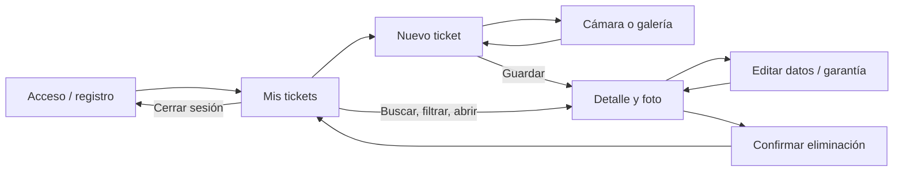
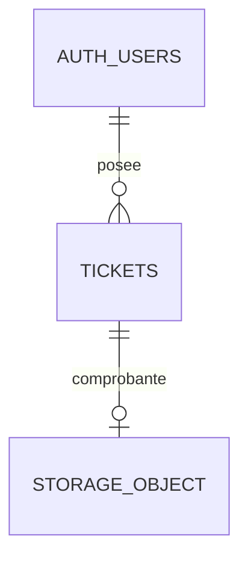

# Análisis y diseño

**TicketGuard · Modalidad A · Entrega del 23 de noviembre de 2026**

## Problema y alcance

Una persona que necesita comprobar una compra o usar la garantía debe localizar un ticket físico o una foto entre muchas. Los tickets de papel pueden deteriorarse y las fotos sueltas carecen de datos de búsqueda. TicketGuard permite digitalizar la evidencia en el momento de la compra y recuperarla por producto o tienda. El móvil aporta cámara, consulta en el establecimiento con conectividad limitada y avisos del sistema.

El flujo parte de la [propuesta aprobada](propuesta.md) y de un caso documentado. Profeco recomienda conservar el ticket de compra y documenta que una reclamación requiere acreditar la relación de consumo. Esto confirma la necesidad de recuperar un comprobante al reclamar. Para convertirlo en un recorrido de prueba se usó el ejemplo de compra de audífonos y consulta posterior en tienda. La observación directa con una persona usuaria está pendiente. [Conservación de tickets según Profeco](https://www.gob.mx/profeco/prensa/profeco-recuerda-a-las-y-los-consumidores-la-importancia-de-pedir-y-guardar-tickets-de-compra) · [Caso documentado de reclamación](https://www.gob.mx/profeco/documentos/tuviste-algun-problema-de-consumo?state=published).


Un desarrollador asume análisis, interfaz, servicios, base de datos, pruebas y documentación. El PDF, §§2, 13 y 14, exige equipos de 3 o 4 integrantes y asigna 10 % a colaboración en GitHub. La propuesta presentada describe trabajo individual. Queda por corroborar con el docente cómo aplica el requisito de equipo y cómo se evalúa ese rubro. La bitácora y el historial registran contribuciones reales.

La propuesta original planteó almacenamiento local. El encargo actual incorpora Auth, Postgres y Storage privados de Supabase. Se conserva el requisito de consulta sin red mediante una copia privada de los comprobantes sincronizados de la cuenta activa. El alta, edición, eliminación y sincronización requieren conexión. Se incluyen foto de cámara o galería, consulta, datos de compra, garantía y aviso local; OCR, verificación con comercios, cuentas compartidas y edición sin conexión quedan para otra versión.

## Historias y criterios de aceptación

| ID | Historia | Criterio comprobable |
| --- | --- | --- |
| H01 | Como comprador, quiero entrar a mi cuenta para conservar mis comprobantes en privado. | Registro e inicio con correo y contraseña; si el correo requiere confirmación, se informa. Una cuenta B no puede leer ni mutar la fila o foto de A aun conociendo su identificador. |
| H02 | Como comprador, quiero fotografiar un ticket y registrar la compra para recuperarlo más adelante. | El formulario muestra una vista previa. Al guardar con producto, tienda, fecha, importe MXN y foto, la compra y el comprobante quedan asociados y aparecen al reabrir. Si falla la conexión no se muestra éxito. |
| H03 | Como comprador, quiero buscar por producto o tienda para encontrar mi comprobante. | «audifonos» encuentra «Audífonos»; abrir el resultado muestra la foto y los datos de compra. Si la compra y foto están sincronizadas, la consulta funciona sin red con la sesión local existente. |
| H04 | Como comprador, quiero registrar la garantía y recibir un aviso antes de que termine. | La garantía admite una fecha desde la compra. Con permiso habilitado, se programa un aviso local a las 09:00, siete días o un día antes. Si el aviso ya pasó o se deniega el permiso, el estado explica qué ocurrió y la compra se conserva. |
| H05 | Como comprador, quiero corregir la información o eliminar un comprobante. | Cambiar el producto o la fecha de garantía actualiza el detalle y reconcilia el aviso. La eliminación requiere confirmación; tras completarse no se ofrece el registro ni el archivo. |
| H06 | Como comprador, quiero recibir mensajes claros cuando haya un error. | El formulario marca campos inválidos, mantiene la captura al fallar el guardado y permite reintentar. Una lista vacía invita a registrar y la falta de conexión distingue la vista de la copia local. |

Requisitos funcionales RF1 cuenta y sesión, RF2 captura y registro, RF3 consulta/búsqueda y copia para lectura, RF4 garantía/aviso, RF5 edición y borrado. Requisitos no funcionales RNF1 aislamiento por propietario en base y Storage, RNF2 validación de JPEG de hasta 5 MiB y datos con límites, RNF3 interfaz legible con botones accesibles, RNF4 escrituras idempotentes para reintento y errores visibles, RNF5 persistencia tras reinicio, RNF6 identidad Android propia y compilación reproducible.

## Navegación y bocetos



```text
┌ Acceso ──────────┐  ┌ Mis tickets ───────┐  ┌ Nuevo ticket ───────┐  ┌ Detalle ───────────┐
│ ◉ TicketGuard    │  │ TicketGuard    ↻  │  │ ‹                   │  │ ‹              ⋮  │
│ Correo           │  │ Mis tickets       │  │ [Cámara] [Galería]   │  │ Audífonos         │
│ Contraseña       │  │ [Buscar _______]  │  │ Vista previa         │  │ Tienda · $1,299   │
│ [Entrar]         │  │ Todas | Próximas  │  │ Producto · Tienda    │  │ Compra 15 nov     │
│ Crear cuenta     │  │ Audífonos       › │  │ Fecha · Importe      │  │ Garantía y aviso  │
│                  │  │ [+ Nuevo ticket]  │  │ Garantía · Aviso     │  │ Foto ampliable    │
│                  │  │                   │  │ [Guardar ticket]     │  │ [Editar datos]    │
└──────────────────┘  └───────────────────┘  └─────────────────────┘  └───────────────────┘
```

Identidad: fondo marfil #F6F5EF, tinta #182C29, verde principal #146658, menta #D9F1E7, ámbar #865100 para avisos. Roboto del sistema. Contraste de texto y controles con etiquetas, fechas e importes localizados, foco visible y contenido desplazable. Los estados contemplan carga, lista vacía, búsqueda sin coincidencias, éxito, fallo de red, copia local y falta de permiso. Al tocar Cámara, Android abre su aplicación de captura. Galería usa el selector del sistema; la app no pide permiso general para leer archivos. El permiso para notificaciones se solicita al activar un aviso.

## Modelo y decisiones técnicas



Flutter separa pantallas y estado de presentación, modelo de ticket y adaptadores de persistencia/avisos. Supabase Auth autentica. Postgres guarda el UUID, propietario, producto, tienda, fecha de compra, importe entero en centavos MXN, garantía y anticipación. Storage usa el bucket privado `receipt-images` y la ruta `<uid>/<ticket-id>.jpg`. La app descarga la foto con el token de la sesión, sin enlaces públicos. RLS de Postgres acota por propietario y RLS de Storage exige la ruta de un ticket propio. Una fila provisional permite reintentar subir la foto con el mismo UUID y el listado filtra compras listas. Una eliminación se marca antes de retirar la imagen y se puede retomar si falla antes de completar el borrado.

La copia local vive en almacenamiento privado de la aplicación por cuenta y se elimina al cerrar sesión. Se deshabilitan copias de seguridad Android para evitar exportar comprobantes o sesiones. La app solo recibe la URL y la clave publicable. El aviso se programa en el dispositivo con contenido genérico para proteger datos en la pantalla bloqueada, en horario local y con la flexibilidad que permite el sistema. Cerrar sesión cancela los avisos del dispositivo. [Políticas de Storage](https://supabase.com/docs/guides/storage/security/access-control) · [RLS de Postgres](https://supabase.com/docs/guides/database/postgres/row-level-security).

## Recorrido de demostración

Entrar con una cuenta de prueba, tomar una foto sintética, intentar guardar un importe inválido, guardar con datos correctos y garantía, buscar por tienda, abrir la foto, cerrar y reabrir, consultar la copia en modo avión y comprobar que otra cuenta no puede abrir el ticket ni la foto. Mostrar en Android la entrega de un aviso de prueba y explicar la hora local y la autorización del sistema.
